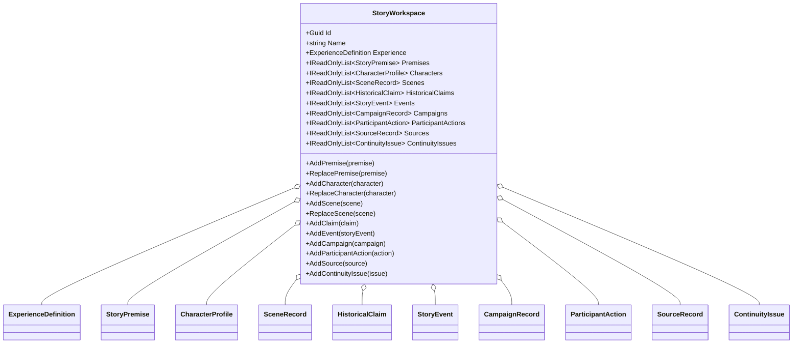

# StoryWorkspace UML

## Class diagram

## Use case

The host creates one workspace for an Experience, captures StoryPremise proposals through the Narrator, then adds fictional and campaign records without mixing them with the Experience's implementation record. The workspace exposes read-only collection views and controlled add/replace operations for character and scene edits. Storage and UI remain host or adapter responsibilities.
