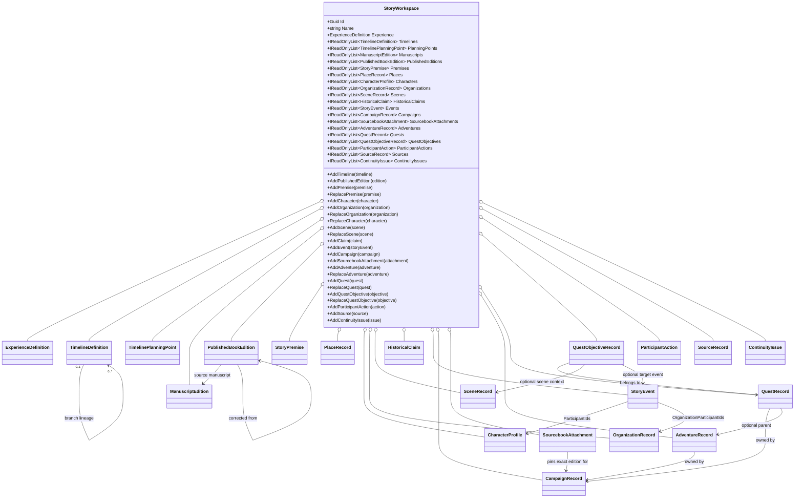

# StoryWorkspace UML

## Class diagram

## Use case

The host creates one workspace for an Experience, captures StoryPremise proposals through the Narrator, and registers timeline definitions before executing them through an optional runtime adapter. A branch must point to a parent already registered in that workspace. The host then adds fictional and campaign records without mixing them with the Experience's implementation record. Campaigns can pin exact sourcebook editions, group adventures, and organize quests into ordered objectives. These are preparation structures, not a forced plot path; objectives may be pursued in any order and participant choices remain independent records. The workspace exposes read-only collection views; storage and UI remain host or adapter responsibilities. Published editions are append-only snapshots with content hashes and correction lineage, separate from mutable manuscript drafts.
