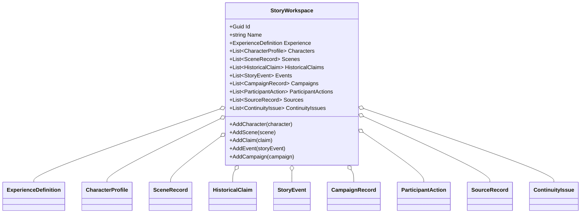

# StoryWorkspace UML

## Class diagram

## Use case

The host creates one workspace for an Experience, then adds fictional and campaign records without mixing them with the Experience's implementation record. Storage and UI are intentionally owned by the host or an adapter.
