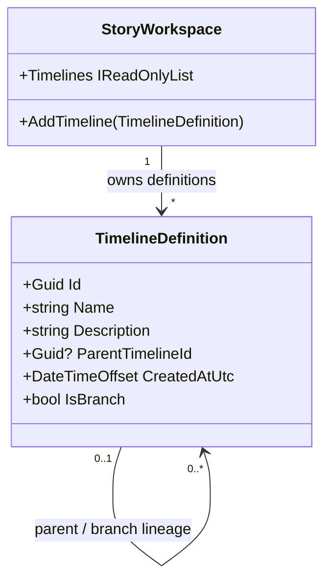

# TimelineDefinition UML

## Use cases

- Create a timeline and register it in a workspace.
- Create a branch only when its parent timeline already exists in the same workspace.
- Keep timeline identity independent of display numbers, Process Group runtime objects, and manuscript order.

## Implementation note

The class diagram reflects the canonical domain record and its workspace ownership. Runtime execution is supplied by the optional TimelineProcessGroup adapter.
