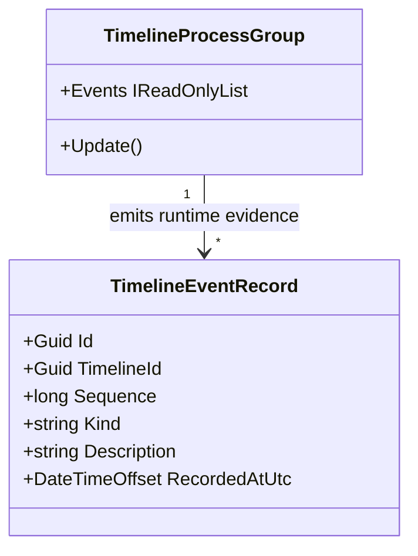

# TimelineEventRecord UML

## Use cases

- Inspect a timeline's Process Group entry and update observations.
- Distinguish an event's stable identity from its position in a particular timeline's runtime sequence.
- Verify that updates to one timeline do not appear in another timeline's event stream.

## Boundary

These records are runtime observations. They do not by themselves declare a fictional event accepted canon.
