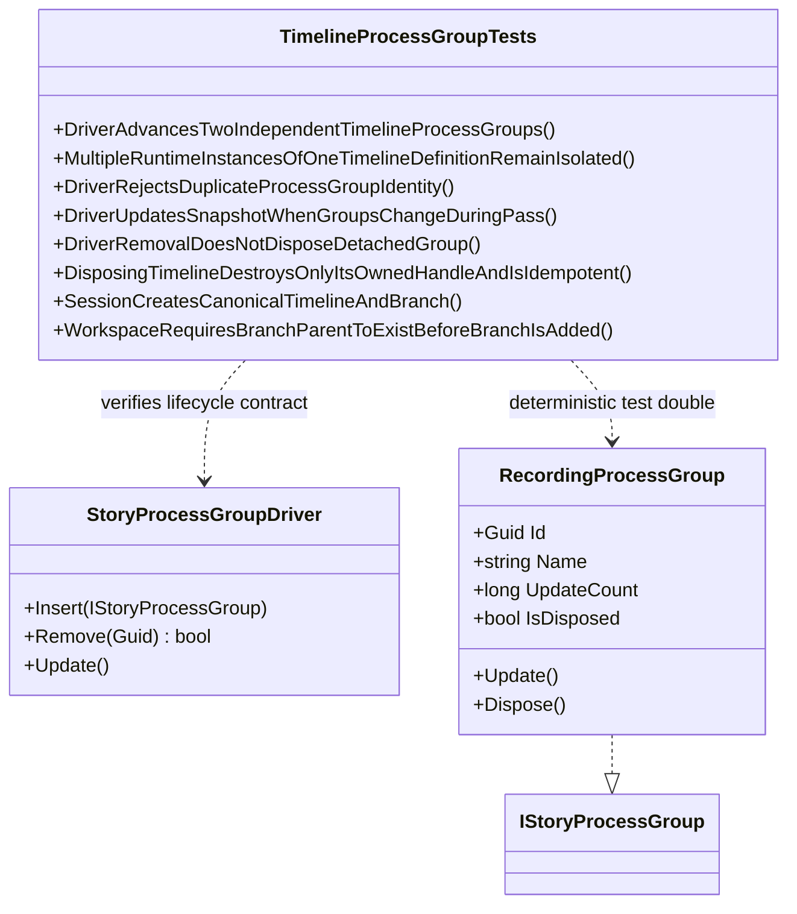

# TimelineProcessGroupTests UML

## Use cases

- Verify independent FSM_API-backed timeline groups advance without mixing runtime observations.
- Verify separate runtime instances of one canonical timeline definition do not share an FSM_API processing group.
- Verify duplicate identities are rejected.
- Verify a group inserted during an update pass waits until the next pass, while a group removed during that pass may still receive the snapshotted update.
- Verify removing a disposable group detaches it without disposing it; the host remains responsible for disposal.
- Verify disposing one timeline adapter is idempotent, invokes its exit callback, rejects subsequent updates, and does not stop an independent timeline adapter.
- Verify canonical timeline branching requires an existing parent.

## Verification boundary

These tests specify the local driver contract only. They do not establish production FSM_Foundry scheduling, cancellation, or run-evidence integration.
