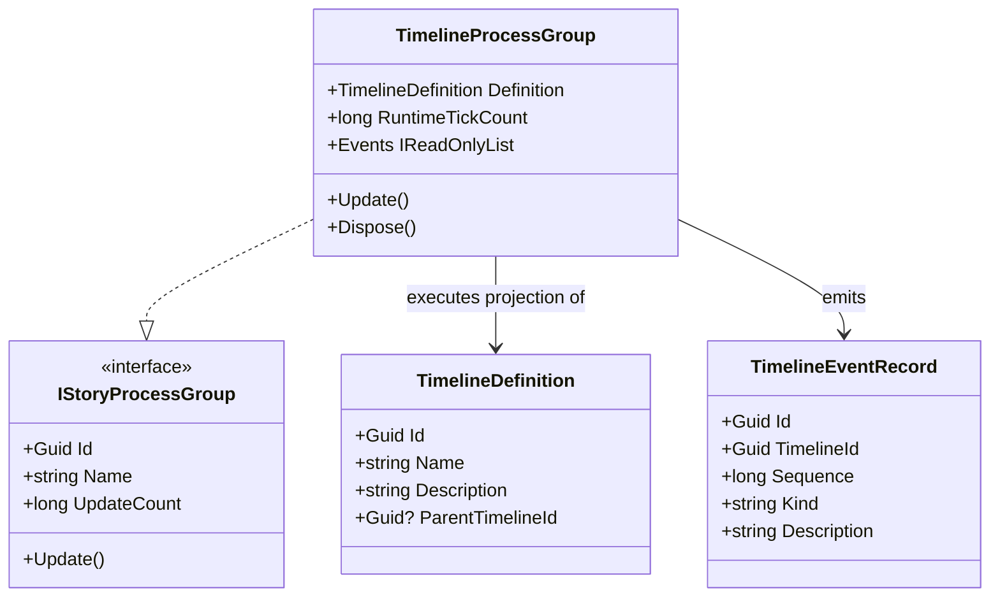

# TimelineProcessGroup UML

## Use cases

- Construct one executable Process Group from a canonical timeline definition.
- Insert it into a driver and inspect its runtime event observations.
- Dispose the runtime adapter without deleting or mutating the canonical timeline definition.

## Boundary

The adapter is optional and FSM_API-backed. StoryBuilder.Core stays independent of the runtime package.
