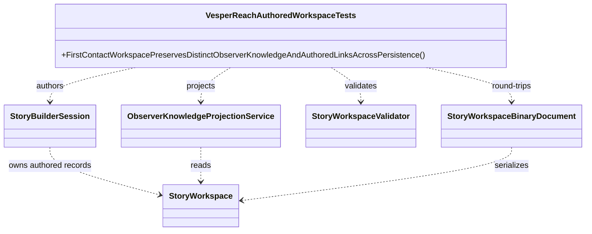
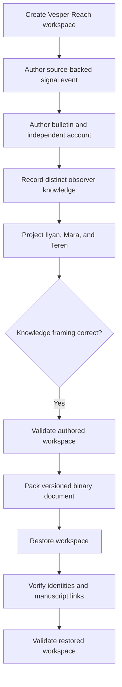

# VesperReachAuthoredWorkspaceTests UML

## Class diagram

## Scenario flow

## Use cases

- A direct witness can receive the primary signal as a direct fact.
- A courier who learned through the official bulletin receives only an attributed report, not direct-fact framing.
- An uninformed observer receives no signal event in their projection.
- An independent courier account remains distinct from the station bulletin.
- The scene, place assignment, event provenance, observer knowledge, and manuscript links survive the binary round trip with stable identifiers.
