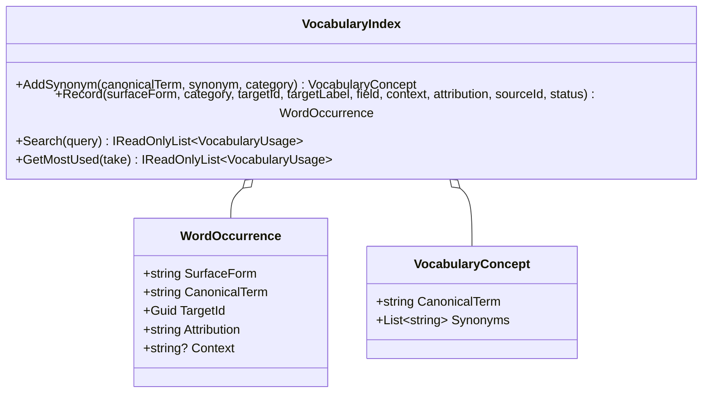

# VocabularyIndex UML

## Class diagram

## Use case

A writer adds an adjective once, then discovers its uses across the story domain. Synonym search groups related terms while preserving the actual words and the speaker or source that used them.
