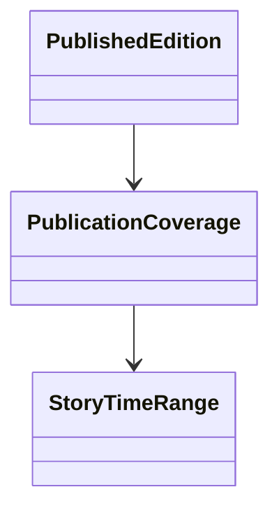

# PublicationCoverage

Connects a publication unit—such as a chapter or volume—to the story-time interval it presents. Published editions are immutable snapshots with fixed identity and coverage.

## Use cases

- Compare publication sequence with fictional chronology.
- Determine which story-time interval a chapter covers.
- Preserve what a published edition represented when later canon changes.

## UML

