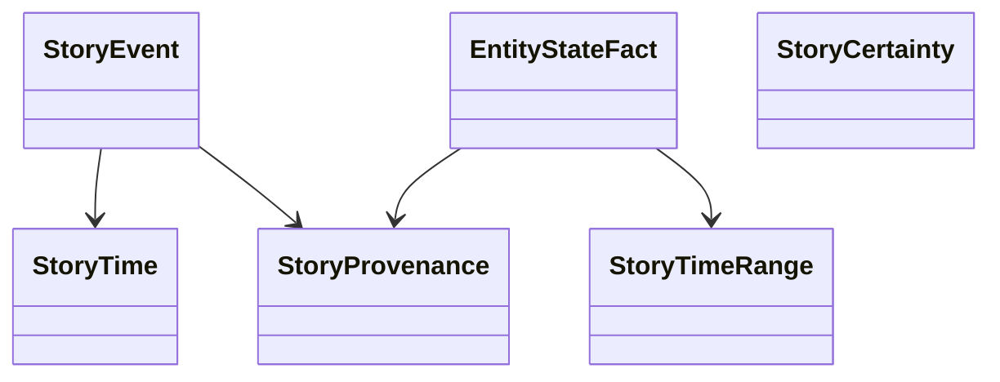

# StoryFacts

StoryBuilder-owned temporal domain records for story events, entity-state facts, certainty, and provenance. The records keep fictional assertions separate from manuscript presentation and retain source identity for review.

## Use cases

- Capture a stable event record with participants and source provenance.
- Distinguish confirmed, inferred, proposed, and contested assertions.
- Represent entity properties over explicit story-time ranges.

## UML

