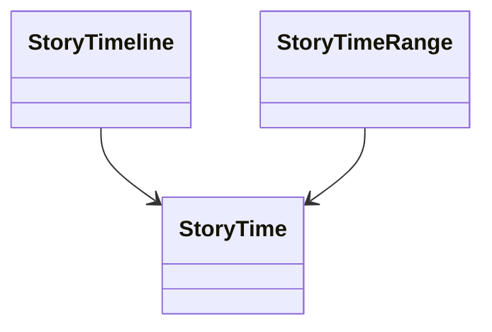

# StoryTime

Defines a named temporal coordinate system for a story world, including timelines and half-open ranges.

## Use cases

- Place events on a named timeline without conflating story time and publication order.
- Validate that range endpoints belong to the same timeline.
- Express when an entity-state assertion is valid.

## UML

