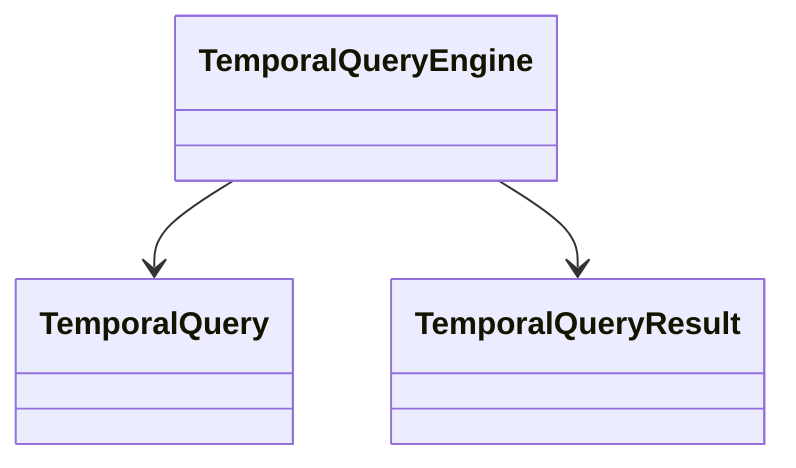

# TemporalQueryEngine

Queries events and time-bounded state facts at a selected story-time coordinate, with optional entity focus and proposal filtering. Results retain conflict information rather than silently resolving contradictory claims.

## Use cases

- Ask what events occur at a particular story time.
- Inspect the facts about a selected character at that time.
- Surface conflicting property assertions for continuity review.

## UML

